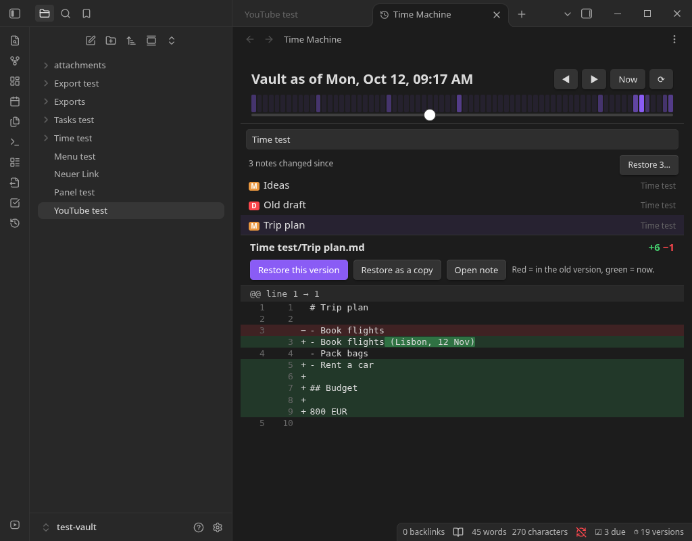

# Vault Time Machine for Obsidian

Scrub your whole vault back through time. Drag a slider to see every note that changed since then, read
the diff, and restore one note or all of them. No git, no sync service, no setup. Works on desktop and mobile.

<a href="https://www.paypal.com/donate/?hosted_button_id=H4SCC24R8KS4A"></a>



## What it does

- **Time slider for the whole vault.** The strip above the slider shows when you were editing, so you can
  jump to a busy day. ◀ ▶ step to the previous or next change anywhere in the vault; **Now** snaps back.
- **See what changed since.** Pick a moment and the list shows every note that was added (A), edited (M)
  or deleted (D) since, with a diff against the note as it is now. Changed words are highlighted inside a
  rewritten line.
- **Restore safely.** Restore one note, restore it as a copy next to the original, bring back a deleted
  note, or restore everything that changed since that moment. The current text is saved first, so a
  restore can always be undone. Notes created after the moment are never deleted.
- **Automatic.** A note's new state is saved after you stop editing it for 20 seconds. Notes edited while
  Obsidian was closed are picked up on the next start. Renames and deletions are tracked.
- **Stays small.** Identical content is stored once. Old history thins out like Starnote's: every version
  for a day, hourly for a week, daily for three months, weekly after that. Optionally drop history older
  than N days. The newest version of every note is always kept.
- **Private and local.** History lives in `.obsidian/plugins/vault-time-machine/history` inside your vault
  and never leaves your device.

Commands: **Open Time Machine**, **Show history of this note**, **Save a snapshot of every note now**,
**Thin out old history now**.

## Install

### Obsidian directory

Vault Time Machine is listed in the official Obsidian plugin directory: [community.obsidian.md/plugins/vault-time-machine](https://community.obsidian.md/plugins/vault-time-machine). Install it from there, or from Settings → Community plugins → Browse once it appears for you.

### BRAT (installs and keeps it updated)

1. Install **BRAT** from Settings → Community plugins → Browse, and enable it.
2. Run **BRAT: Add a beta plugin for testing** and enter `encomjp/obsidian-time-machine`, or click
   [this link](obsidian://brat?plugin=encomjp/obsidian-time-machine) with BRAT installed.
3. Enable **Vault Time Machine** under Settings → Community plugins.

### Manual

Copy `main.js`, `manifest.json` and `styles.css` from the latest release into
`<vault>/.obsidian/plugins/vault-time-machine/`, then enable the plugin. To build it yourself:

```bash
npm install
npm run build
```

## Notes and limits

- Only Markdown notes are tracked (not attachments). Notes larger than 2 MB are skipped by default, and
  folders can be excluded in the settings.
- History starts when you install the plugin; existing notes begin at their last-modified time.
- This is a safety net, not a backup. Keep a real backup of your vault too.

## Development

```bash
npm run dev     # rebuild main.js on change
npm run check   # type-check
npm test        # unit tests (node --test): diff engine and history store
```

The engine (`src/history.ts`, `src/diff.ts`) has no Obsidian dependency and is covered by 29 tests,
including a randomised diff round-trip test and a concurrency test for the store. Tested in Obsidian
1.14.4 (Flatpak, Linux).

## Support

If this saves you time, you can [buy me a coffee](https://www.paypal.com/donate/?hosted_button_id=H4SCC24R8KS4A).

## Disclaimer

An independent project, ported from Starnote's version history. It is not affiliated with, endorsed by,
or supported by Dynalist Inc. (Obsidian). Provided "as is" under the MIT license, without warranty. It
writes to your notes when you restore, so keep your own backups. See [LICENSE](LICENSE).
